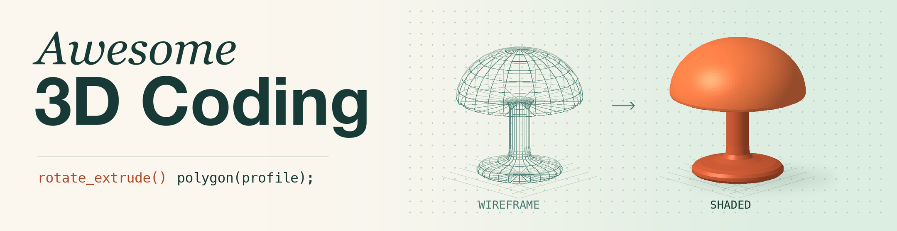

<h1 align="center"></h1>

Papers, benchmarks, and datasets on generating 3D content as editable code, from Blender scenes and parametric CAD parts to interactive Three.js worlds.

  
  
  
  
  

<strong>🧭 Browse the full collection</strong>

- [3D Coding Benchmarks](#3d-coding-benchmarks)
  - [Asset Creation and Editing](#asset-creation-and-editing)
  - [Parametric CAD and Assembly](#parametric-cad-and-assembly)
  - [Interactive Worlds](#interactive-worlds)
- [Datasets for 3D Code](#datasets-for-3d-code)
  - [Procedural Assets and Scene Programs](#procedural-assets-and-scene-programs)
  - [Parametric CAD Programs](#parametric-cad-programs)
- [Models for 3D Code Generation](#models-for-3d-code-generation)
  - [Text to CAD](#text-to-cad)
  - [Shape to Code](#shape-to-code)
  - [Images and Drawings to Programs](#images-and-drawings-to-programs)
  - [Shape Program Synthesis](#shape-program-synthesis)
- [3D Modeling Agents](#3d-modeling-agents)
  - [Objects and Articulation](#objects-and-articulation)
  - [Scene Layout and Generation](#scene-layout-and-generation)
  - [Visual Editing and Inverse Graphics](#visual-editing-and-inverse-graphics)
- [Evaluation Metrics](#evaluation-metrics)
- [Development Tools](#development-tools)
- [Related Collections](#related-collections)
- [Contributing](#contributing)

## 📏 3D Coding Benchmarks

Compare a Blender asset against reference views, test a CAD solid against its design brief, or trigger a browser interaction and inspect how the scene responds.

### Asset Creation and Editing

| Benchmark | Publication | Task and evaluation | Resources |
| --- | --- | --- | --- |
| **BlenderGym** | CVPR 2025 | Edit a starting Blender scene to match a target. Its 245 scenes cover geometry, lighting, materials, blend shapes, and placement. | [Paper](https://openaccess.thecvf.com/content/CVPR2025/html/Gu_BlenderGym_Benchmarking_Foundational_Model_Systems_for_Graphics_Editing_CVPR_2025_paper.html) · [Code](https://github.com/richard-guyunqi/BlenderGym-Open) · [Leaderboard](https://blendergym.github.io/) |
| **3DCodeBench** | NeurIPS 2026 | Write Blender Python from text or reference views across 212 asset categories. Scorers check execution, mesh geometry, and rendered appearance. | [Paper](https://arxiv.org/abs/2606.01057) · [Code](https://github.com/gaoypeng/3dcodebench) · [Leaderboard](https://www.3dcodebench.com/) |
| **BlenderWorld** | arXiv 2026 | Deliver editable Blender projects for 223 creation briefs. Multi-view renders are scored against task-specific criteria and for overall visual quality. | [Paper](https://arxiv.org/abs/2610.23986) · [Code](https://github.com/QwenLM/BlenderWorld) · [Gallery](https://blenderworld.github.io/) |
| **IR3D-Bench** | NeurIPS 2025 | Recreate a scene from an image with programming and rendering tools. Score object geometry, relative placement, and appearance. | [Paper](https://arxiv.org/abs/2506.23329) · [Code](https://github.com/LiuHengyu321/IR3D-Bench) |
| **BlenderBench (VIGA)** | arXiv 2026 | Follow multi-step visual editing tasks in Blender Python across three difficulty levels. | [Paper](https://arxiv.org/abs/2601.11109) · [Dataset](https://huggingface.co/datasets/DietCoke4671/blenderbench) |
| **3DHarnessBench** | arXiv 2026 | Recover an object as Blender Python under four access settings, from a single reference view to active inspection of the target in Blender. | [Paper](https://arxiv.org/abs/2609.06535) · [Project](https://3dharnessbench.com/) |
| **SceneActBench** | arXiv 2026 | Act on multi-object scenes from images or video frames. Five tasks yield 520 cases from 210 source instances, scored against hidden geometry. | [Paper](https://arxiv.org/abs/2607.22393) · [Code](https://github.com/Feinaldo2/SceneActBench) |
| **Code3DBench** | 2026 release | Write Three.js object-building code from a single reference render. A fixed browser scaffold renders the result across 1,012 low-poly objects. | [Code](https://github.com/VladimirGl/Code3DBench) |

### Parametric CAD and Assembly

| Benchmark | Publication | Task and evaluation | Resources |
| --- | --- | --- | --- |
| **CADTestBench** | NeurIPS 2026 | Build a part from a written specification. Executable tests query the resulting solid for the geometric and topological properties requested in the prompt. | [Paper](https://arxiv.org/abs/2605.07807) · [Code](https://github.com/dimitrismallis/CADTestBench) · [Examples](https://dimitrismallis.github.io/cadtests/) |
| **P3D-Bench** | arXiv 2026 | Generate parts or assemblies from text or images. The evaluation uses 100 cases from each of three task families and checks dimensions, topology, and part structure. | [Paper](https://arxiv.org/abs/2606.11152) · [Code](https://github.com/SpatiaOS/P3D-Bench) · [Dataset](https://huggingface.co/datasets/SpatiaOS/P3D-Bench) |
| **BenchCAD** | arXiv 2026 | Read, generate, or edit industrial CadQuery programs across 106 part families. Image-to-code and code-edit tasks compare the resulting solid with a target. | [Paper](https://arxiv.org/abs/2605.10865) · [Code](https://github.com/BenchCAD/BenchCAD-main) |
| **CADBench** | arXiv 2026 | Recover editable CAD from meshes or rendered views. Its 18,000 evaluation samples test geometric fidelity, executability, and program compactness. | [Paper](https://arxiv.org/abs/2605.10873) · [Code](https://github.com/anniedoris/CADBench) · [Dataset](https://huggingface.co/datasets/DeCoDELab/CADBench) |
| **Text2CAD-Bench** | arXiv 2026 | Generate a part from either a geometric description or procedural instructions. The 600 curated examples span four complexity levels. | [Paper](https://arxiv.org/abs/2605.18430) |

### Interactive Worlds

| Benchmark | Publication | Task and evaluation | Resources |
| --- | --- | --- | --- |
| **WorldCoder-Bench** | arXiv 2026 | Build an interactive Three.js world. StateProbe triggers actions in a browser and checks resulting state transitions. | [Paper](https://arxiv.org/abs/2606.01869) · [Code](https://github.com/shuolucs/WorldCoder-Bench) |
| **VoxelCodeBench** | arXiv 2026 | Execute generated voxel-manipulation code in Unreal Engine. Tasks cover symbol interpretation, geometric construction, and artistic composition. | [Paper](https://arxiv.org/abs/2604.02580) |
| **WorldBench** | arXiv 2026 | Use one detailed voxel-island brief to test an open-ended Three.js world. The judge inspects source, navigates between biomes, and advances the in-world clock. | [Paper](https://arxiv.org/abs/2610.10622) |

## 🗂️ Datasets for 3D Code

### Procedural Assets and Scene Programs

| Dataset | Reported scale | What a sample contains | Release |
| --- | --- | --- | --- |
| **3DCodeData** | 12,720 asset instances from 212 procedural generators | One parameterized Blender asset with scripts, captions, four rendered views, and textured and geometry-only mesh exports. | [Dataset](https://huggingface.co/datasets/YipengGao/3DCode) |
| **3DCodeVerse-2M** | 2,028,286 caption–program pairs in the merged text split | One caption paired with code. The same program can have several captions. The corpus spans Blender Python, CadQuery, OpenSCAD, Three.js, GLSL, and URDF. | [Dataset and schema](https://huggingface.co/datasets/3dcodeverse/3dcodeverse-2m) |
| **BlenderRAG** | 500 objects in 50 categories | A Blender Python script, its rendered image, and a text description. Indoor and outdoor subsets each contain 250 objects. | [Dataset](https://huggingface.co/datasets/MaxRondelli/BlenderRAG) · [Paper](https://arxiv.org/abs/2605.00632) |
| **MeshCoder object corpus** | 1 million object–code pairs in the study | An Infinigen-derived object paired with a Blender program organized by semantic part. The paper separately describes synthetic part-level training pairs. | [Paper](https://arxiv.org/abs/2508.14879) · [Code](https://github.com/InternRobotics/MeshCoder) |
| **ShapeAssembly programs** | 3 released furniture categories | A PartNet-derived chair, table, or storage design encoded as a hierarchy of cuboids and attachment operations. The release includes parsed programs and their interpreter. | [Code](https://github.com/rkjones4/ShapeAssembly) · [Paper](https://arxiv.org/abs/2009.08026) |
| **VLMaterial** | 1,640 seed materials, over 550,000 after augmentation | A procedural Blender material encoded as Python and paired with a render. The authors vary both shader graph structure and node parameters. | [Code](https://github.com/mit-gfx/VLMaterial) · [Paper](https://arxiv.org/abs/2501.18623) |

### Parametric CAD Programs

| Dataset | Reported scale | What a sample contains | Release |
| --- | --- | --- | --- |
| **Text-to-CadQuery** | 170,000 annotated Text2CAD examples | A part description paired with CadQuery code that constructs the solid. | [Annotations](https://huggingface.co/ricemonster/NeurIPS11092/blob/main/CadQuery.zip) · [Scripts](https://github.com/Text-to-CadQuery/Text-to-CadQuery) |
| **CAD-Recode** | 1 million generated CAD sequences in the ICCV study | A sequence of sketch and extrusion operations expressed in Python. The authors sample points on the resulting geometry to train a model to recover the code. | [Project and data releases](https://cad-recode.github.io/) |
| **Fusion 360 Gallery Reconstruction** | 8,625 human design sequences | The ordered sketches and extrusions that a user performed to build a CAD part. The project includes tools to replay the construction history. | [Dataset](https://github.com/AutodeskAILab/Fusion360GalleryDataset/blob/master/docs/reconstruction.md) · [Paper](https://arxiv.org/abs/2010.02392) |
| **DeepCAD** | 178,238 CAD models | A solid paired with the sequence of sketch and extrusion commands that constructs it, encoded as operations and parameters. | [Project](https://www.cs.columbia.edu/cg/deepcad/index.html) |
| **Text2CAD** | About 170,000 models and 660,000 text annotations | DeepCAD construction sequences paired with descriptions ranging from a short shape specification to detailed modeling instructions. | [Code](https://github.com/SadilKhan/Text2CAD) · [Dataset](https://huggingface.co/datasets/SadilKhan/Text2CAD) |
| **CAD-Coder training data (Guan et al.)** | 156,954 rows in the full synthesized training file | A geometric description and executable CadQuery answer. The release identifies the smaller subset used for supervised fine-tuning. | [Dataset](https://huggingface.co/datasets/gudo7208/CAD-Coder) |
| **GenCAD-Code (Doris et al.)** | Over 163,000 image–code pairs | A CAD render paired with the CadQuery Python script for reconstructing the solid from that view. | [Dataset](https://github.com/anniedoris/GenCAD-Code) · [Paper](https://arxiv.org/abs/2505.14646) |
| **Zero-to-CAD 1M** | 1 million construction sequences | A synthetic CadQuery program with its operation list and exported STEP geometry. Programs come from an agent interacting with a CAD execution environment. | [Dataset](https://huggingface.co/datasets/ADSKAILab/Zero-To-CAD-1m) · [Paper](https://arxiv.org/abs/2604.24479) |
| **Ortho2CAD drawings** | Over 1 million drawings generated in the study | Orthographic projections rendered from STEP geometry, including hidden lines. The released DeepCAD and Fusion 360 subsets provide drawings and training annotations. | [Code](https://github.com/AdityaJoglekar/Ortho2CAD) · [Paper](https://arxiv.org/abs/2607.08891) |

## 🧊 Models for 3D Code Generation

### Text to CAD

| Method | Publication | Input → program | Highlight | Resources |
| --- | --- | --- | --- | --- |
| **Text-to-CadQuery** | arXiv 2025 | Part description → CadQuery Python | Fine-tunes language models to turn a specification into an editable parametric solid. | [Paper](https://arxiv.org/abs/2505.06507) · [Code](https://github.com/Text-to-CadQuery/Text-to-CadQuery) |
| **CAD-Coder (Guan et al.)** | NeurIPS 2025 | Part description → CadQuery Python | Trains on paired examples, then uses distance between the generated and target shapes as a reward. | [Paper](https://arxiv.org/abs/2505.19713) · [Code](https://github.com/gudo7208/CAD-Coder) |
| **Text2CAD** | NeurIPS 2024 | Description → CAD operation sequence | Predicts sketch and extrusion operations from instructions with different levels of detail. | [Paper](https://arxiv.org/abs/2409.17106) · [Code](https://github.com/SadilKhan/Text2CAD) |
| **CAD-Editor** | ICML 2025 | Existing CAD sequence + edit request → revised sequence | Locates the operations affected by an instruction, then infills that portion of the construction sequence. | [Paper](https://proceedings.mlr.press/v267/yuan25g.html) · [Code](https://github.com/microsoft/CAD-Editor) |

### Shape to Code

| Method | Publication | Input → program | Highlight | Resources |
| --- | --- | --- | --- | --- |
| **CAD-Recode** | ICCV 2025 | Point cloud → CadQuery Python | Recovers the sketches and extrusions that build a solid. Editing a sketch dimension changes the reconstructed part. | [Paper](https://openaccess.thecvf.com/content/ICCV2025/html/Rukhovich_CAD-Recode_Reverse_Engineering_CAD_Code_from_Point_Clouds_ICCV_2025_paper.html) · [Code](https://github.com/filaPro/cad-recode) · [Project](https://cad-recode.github.io/) |
| **MeshCoder** | NeurIPS 2025 | Point cloud → Blender Python | Represents a mesh as a program organized by part, so a user can modify one component of the reconstruction. | [Paper](https://arxiv.org/abs/2508.14879) · [Code](https://github.com/InternRobotics/MeshCoder) · [Project](https://daibingquan.github.io/MeshCoder/) |
| **cadrille** | ICLR 2026 | Point cloud, image, or text → CAD code | Trains one model across all three input modalities and refines it using feedback from program execution. | [Paper](https://arxiv.org/abs/2505.22914) · [Code](https://github.com/col14m/cadrille) |

### Images and Drawings to Programs

| Method | Publication | Input → program | Highlight | Resources |
| --- | --- | --- | --- | --- |
| **CAD-Coder (Doris et al.)** | arXiv 2025 | Part image → CadQuery Python | Fine-tunes a vision-language model on the GenCAD-Code image–program pairs for editable single-view CAD reconstruction. | [Paper](https://arxiv.org/abs/2505.14646) · [Code](https://github.com/anniedoris/CAD-Coder) |
| **Img2CAD** | SIGGRAPH Asia 2025 | Image → parametric CAD representation | Predicts the discrete structure of a design first, then estimates its continuous parameters conditioned on that structure. | [Paper](https://arxiv.org/abs/2408.01437) · [Code](https://github.com/qq456cvb/Img2CAD) |
| **Real2Code** | ICLR 2025 | Object views → joint articulation code | Reconstructs part geometry first. A language model uses oriented part boxes to infer where and how the joints move. | [Paper](https://arxiv.org/abs/2406.08474) · [Project](https://real2code.github.io/) |
| **VLMaterial** | ICLR 2025 | Material image → Blender shader program | Predicts Python that builds a procedural material graph, exposing its nodes and parameters for later edits. | [Paper](https://arxiv.org/abs/2501.18623) · [Code](https://github.com/mit-gfx/VLMaterial) |
| **Ortho2CAD** | arXiv 2026 | Orthographic drawing → CadQuery Python | Uses dimensioned projections for reconstruction. Its refinement loop renders the predicted solid from the drawing views to guide code corrections. | [Paper](https://arxiv.org/abs/2607.08891) · [Code](https://github.com/AdityaJoglekar/Ortho2CAD) |

### Shape Program Synthesis

| Method | Publication | Input → program | Highlight | Resources |
| --- | --- | --- | --- | --- |
| **CSGNet** | CVPR 2018 | Shape → constructive solid geometry program | Parses a target shape into primitives and Boolean operations whose execution reconstructs the geometry. | [Project](https://hippogriff.github.io/CSGNet/) |
| **ShapeAssembly** | SIGGRAPH Asia 2020 | Learned shape representation → assembly program | Generates hierarchical cuboid programs with attachment and symmetry operations. Varying their parameters creates related shapes. | [Paper](https://arxiv.org/abs/2009.08026) · [Code](https://github.com/rkjones4/ShapeAssembly) |
| **ShapeMOD** | SIGGRAPH 2021 | Shape programs → reusable macros | Refactors repeated operations across a collection into shared functions, exposing editable parameters such as leg spacing. | [Project](https://rkjones4.github.io/shapeMOD.html) · [Code](https://github.com/rkjones4/ShapeMOD) |
| **ShapeCoder** | SIGGRAPH 2023 | Unstructured primitives → reusable shape programs | Learns functions shared across shapes and infers a program for each shape using those functions. | [Project](https://rkjones4.github.io/shapecoder.html) · [Code](https://github.com/rkjones4/shapecoder) |

## 🤖 3D Modeling Agents

### Objects and Articulation

| System | Publication | Runtime | How the agent builds or revises a scene | Resources |
| --- | --- | --- | --- | --- |
| **LL3M** | arXiv 2025 | Blender | Writes and debugs scripts for geometry and materials. Rendered views and follow-up instructions guide subsequent edits. | [Paper](https://arxiv.org/abs/2508.08228) · [Gallery](https://threedle.github.io/ll3m/) |
| **3DCodeVerse** | arXiv 2026 | Blender, CAD, and web graphics | Runs the generated program, measures the resulting asset, and inspects renders to identify which part of the program to revise. | [Paper](https://arxiv.org/abs/2610.22341) · [Code](https://github.com/gaoypeng/3dcodeverse) |
| **Articulate-Anything** | ICLR 2025 | Python → URDF | Retrieves part meshes and generates joint and link programs from text, images, or video. Simulated motion gives the critic feedback about articulation. | [Paper](https://arxiv.org/abs/2410.13882) · [Code](https://github.com/vlongle/articulate-anything) |
| **aDSL** | arXiv 2026 | Assembly DSL | Plans and generates shapes with relational placement operators. Execution feedback lets the agent repair violated constraints. | [Paper](https://arxiv.org/abs/2608.17975) · [Code](https://github.com/sig-pku/aDSL) |
| **Procedura** | arXiv 2026 | Parametric assembly programs | Builds named parts joined by typed mates. It checks compilation and connectivity before using rendered views to refine individual parts. | [Paper](https://arxiv.org/abs/2608.26238) |

### Scene Layout and Generation

| System | Publication | Runtime | How the agent builds or revises a scene | Resources |
| --- | --- | --- | --- | --- |
| **SceneCraft** | ICML 2024 | Blender | Assembles assets from a scene description, checks their spatial relationships, and reuses placement functions across scenes. | [Paper](https://proceedings.mlr.press/v235/hu24g.html) |
| **Open-Universe Indoor Scene Generation** | arXiv 2024 | Layout DSL + constraint solver | Compiles language into spatial constraints, solves for object poses, and retrieves meshes to populate the layout. | [Paper](https://arxiv.org/abs/2403.09675) |
| **3D-GPT** | 3DV 2025 | Blender + Infinigen | Selects procedural functions, infers their parameters from instructions, and writes Python calls to build the scene. | [Paper](https://arxiv.org/abs/2310.12945) · [Code](https://github.com/Chuny1/3DGPT) |
| **SceneWeaver** | NeurIPS 2025 | Blender + Infinigen | Combines a scene planner with an executor and uses feedback on intermediate scenes to revise its construction plan. | [Paper](https://arxiv.org/abs/2509.20414) · [Code](https://github.com/Scene-Weaver/SceneWeaver) |
| **Procedural Scene Programs** | SIGGRAPH Asia 2025 | Imperative layout programs | Places each object relative to earlier objects. A program search corrects invalid layouts while preserving the proposed arrangement. | [Paper](https://arxiv.org/abs/2510.16147) |
| **SceneCode** | arXiv 2026 | Blender Python → simulation assets | Turns a room brief into object requests, generates part-level programs, and assembles the results into an editable scene with articulated objects. | [Paper](https://arxiv.org/abs/2605.19587) |

### Visual Editing and Inverse Graphics

| System | Publication | Runtime | How the agent builds or revises a scene | Resources |
| --- | --- | --- | --- | --- |
| **BlenderAlchemy** | ECCV 2024 | Blender | Proposes program edits and evaluates the renders against the visual goal. The examples show how changes to procedural materials affect a scene. | [Paper](https://arxiv.org/abs/2404.17672) · [Code](https://github.com/ianhuang0630/BlenderAlchemyOfficial) |
| **VIGA** | arXiv 2026 | Blender Python | Alternates between writing code, rendering a scene, and inspecting differences from the target to guide the next edit. | [Paper](https://arxiv.org/abs/2601.11109) · [Code](https://github.com/Fugtemypt123/VIGA) |
| **Thinking in Blender (SEIG)** | arXiv 2026 | Blender | Reconstructs one image as an editable scene by refining geometry, materials, composition, and lighting in stages. | [Paper](https://arxiv.org/abs/2606.02580) |

## 📐 Evaluation Metrics

| Property | Measure | What the evaluator inspects | Implementation or protocol |
| --- | --- | --- | --- |
| **Executability** | Execution rate | Whether each script completes in the target runtime. | [3DCodeBench scorers](https://github.com/gaoypeng/3dcodebench/blob/main/metrics/README.md) |
| **Shape** | Chamfer distance | Distances between points sampled on generated and reference surfaces. | [3DCodeBench scorers](https://github.com/gaoypeng/3dcodebench/blob/main/metrics/README.md) |
| **Appearance** | Multi-view image similarity | Corresponding renders of the generated and reference assets. Camera placement affects the comparison. | [3DCodeBench scorers](https://github.com/gaoypeng/3dcodebench/blob/main/metrics/README.md) |
| **CAD requirements** | Test pass rate | Predicates over a solid's geometry and topology, derived from the design brief. | [CADTests](https://github.com/dimitrismallis/CADTestBench) |
| **Interactive behavior** | Verification coverage | Runtime states and transitions observed while the evaluator interacts with the generated scene. | [StateProbe](https://arxiv.org/abs/2606.01869) |

## 🛠️ Development Tools

- **MCP for Blender** connects a coding agent to a running Blender session to inspect objects and execute Python edits. [Code](https://github.com/ahujasid/mcp-for-blender)
- **CQ-editor** provides a graphical debugger for CadQuery. Step through a generated script to see which operation changes a face, edge, or solid. [Code](https://github.com/CadQuery/CQ-editor)

## 📚 Related Collections

- **Awesome AIGC 3D** organizes 3D generation research by asset type and production stage. Its survey tables inspired the format of this collection. [Repository](https://github.com/hitcslj/Awesome-AIGC-3D)
- **Awesome Code as X** covers executable representations for agents. Its *Code as World* section includes scene and simulation programs. [Repository](https://github.com/kkakkkka/awesome-code-as-x)
- **Awesome 3D Skills** catalogs agent integrations for Blender, CAD systems, and game engines. [Repository](https://github.com/zhuyansen/awesome-3d-skills)

## 🤝 Contributing

Add a row under the task your resource addresses and link to a primary source. For a method, identify the program it writes. For a benchmark, describe what gets checked after execution. For a dataset, give the counting unit and describe one sample.
